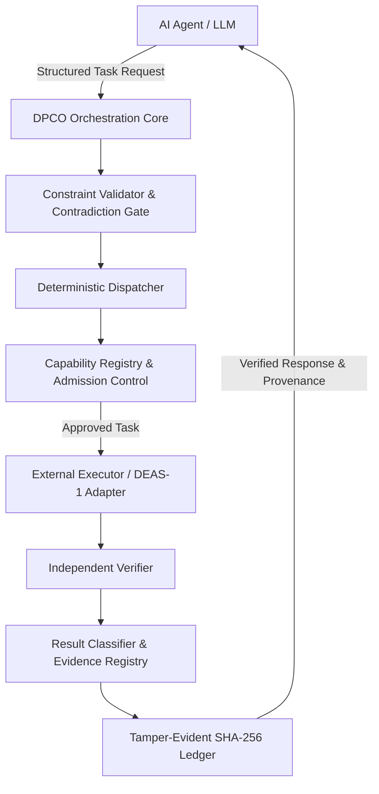

# DPCO (Deterministic Processing & Control Orchestrator)
**Public Architecture Baseline 2.0**  
*Specialized AI Agent Support Middleware for Mathematics and Geometry*

---

## 1. What is DPCO?
DPCO is a specialized orchestration middleware that sits between AI agents (ChatGPT, Gemini, DeepSeek, local models) and deterministic computational engines (exact arithmetic, linear system solvers, 2D geometry engines).

### Core Principle
> **AI Agent THINKS. DPCO ORCHESTRATES. External Executor EXECUTES. Verifier CHECKS. Evidence & Ledger RECORD.**

DPCO does not replace AI language models, nor does it attempt to become a general-purpose application manager. It ensures that mathematical and geometric operations delegated by AI agents are rigorously validated, capability-matched, admission-controlled, independently verified, and cryptographically proven.

---

## 2. The Problem DPCO Solves
AI language models excel at reasoning and planning, but struggle with exact arithmetic precision, geometric construction constraints, and hallucination-free calculations. 

DPCO provides:
- **Formalized Task Routing:** Routes tasks to specialized numerical, exact, or geometric executors.
- **Fail-Closed Admission Governance:** Enforces strict role grants (`PRODUCTION`, `NEGATIVE_CONTROL`, `UNCLASSIFIED`).
- **Epistemic Separation:** Distinguishes execution success (`ExecStatus`) from mathematical truth (`ClaimVerdict`) and independent verification (`VerifyStatus`).
- **Independent Verification:** Cross-checks computational results using autonomous verifiers.
- **Tamper-Evident Provenance:** Records every pipeline transition in a SHA-256 cryptographic ledger.

---

## 3. Architecture Overview

---

## 4. Implementation Status
- **Core & Verification Matrix:** 54 passing tests across Core, CSP-0.2, and Revision 4 Acceptance.
- **DEAS-1 Runtime Contract:** Designed with asynchronous task execution, strict isolation authority, path traversal defense, and SHA-256 artifact verification.

---

## 5. Repository Structure
- `docs/` — Architecture specifications, capability models, and DEAS-1 contracts.
- `core/`, `adapters/`, `verifiers/`, `tests/`, `examples/`, `schemas/` — Scaffolding and core orchestration modules.
- `legacy/dpco-poc-v0.1/` — Preserved historical Python PoC version 0.1 source code and reports.
- `scripts/` — Test execution runners.

---

## 6. License
This project is licensed under the terms of the [MIT License](LICENSE).
